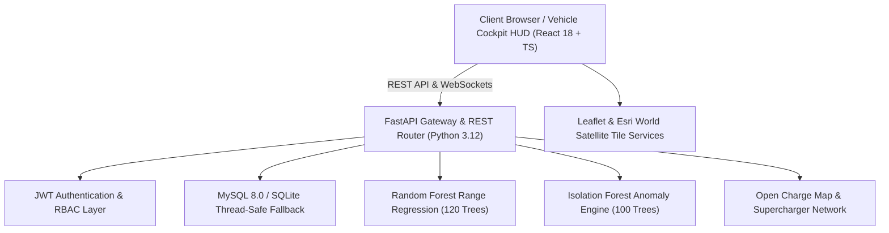

# EV SmartTrace 360 — System Architecture & Design Specification

## 1. High-Level Architecture Overview

EV SmartTrace 360 is an enterprise-grade, cloud-ready Electric Vehicle Intelligence Platform designed to monitor battery health, predict driving range, detect subsystem anomalies, optimize charging routes, and provide an interactive AI voice cockpit.

---

## 2. Core Functional Modules

### A. AI Battery Intelligence (`/battery`)
* **State of Charge (SOC) & Health (SOH):** Real-time bus monitoring with degradation tracking.
* **Deterministic Baseline:**
  $$\text{Available Energy (kWh)} = \text{Capacity (kWh)} \times \frac{\text{SOC}}{100}$$
  $$\text{Theoretical Range (km)} = \frac{\text{Available Energy}}{\text{Consumption (kWh/km)}}$$
* **ML Predictive Range:** Random Forest Regression trained on 6,000 drive cycles incorporating ambient temperature, vehicle speed, HVAC draw, road gradient, and historical driving aggression, providing a $95\%$ confidence interval.

### B. Smart Charging & Energy Analytics (`/energy`)
* **Metered Charging Flow:** Tracks CC (Constant Current) and CV (Constant Voltage) phases.
* **Cost Calculation:**
  $$\text{Charging Cost (\$)} = \text{Energy Consumed (kWh)} \times \text{Tariff Rate (\$/kWh)}$$
* **Unusual Consumption Detection:** Isolation Forest algorithm flags anomalous energy spikes (>20% above historical baseline).

### C. Vehicle Diagnostics & Fault Scanner (`/diagnostics`)
* **Supported Subsystems:** Battery Pack, Dual Electric Motors (AWD), Inverter & Power Electronics, Thermal/Cooling Loop, CAN Bus.
* **Anomaly Classification:** Multi-tier severity scoring (*Normal*, *Information*, *Warning*, *Critical*) with recommended driver actions.

### D. Nearby Charging Station Finder (`/stations`)
* **Interactive Map:** Leaflet map with Satellite, Cyber Dark, and Street Cartography layers.
* **Filtering:** Connector type (Type 2, CCS2, CHAdeMO, NACS/Tesla), charging capacity (50 kW to 350 kW), AC vs DC fast charging.
* **Live Status Transparency:** Clearly denotes verified live status vs estimated historical availability without fabricated guarantees.

### E. Smart Route Optimization (`/navigation`)
* **Workflow:** Ingests start location, destination, vehicle battery capacity, and buffer threshold.
* **Waypoint Calculation:** Automatically plans necessary fast-charging stops along highway corridors when destination exceeds available range.

### F. SmartVoice Conversational Assistant (`/smartvoice`)
* **Web Speech Integration:** Bi-directional speech recognition and text-to-speech synthesis.
* **Telemetry Answering:** Instant acoustic feedback for range queries, battery health, nearest charger lookup, and diagnostic triage.

---

## 3. Database Architecture (MySQL 8.0)

The relational schema strictly enforces foreign key integrity, timestamps, and indexes:
* `users`: User identity, password hash, timestamp.
* `vehicles`: VIN, manufacturer, model, battery capacity (kWh), connector types, efficiency metrics.
* `battery_readings`: Voltage, current, temperature, SOC, SOH, internal resistance.
* `charging_stations`: Latitude, longitude, operator, power rating, pricing, connectors.
* `charging_sessions`: Metered kWh, duration, costs, peak power draw, efficiency.
* `energy_consumption`: Drive cycles, speed, distance, elevation change, AC usage.
* `vehicle_diagnostics`: Diagnostic trouble codes, component, severity, explanations.
* `route_history`: Origins, destinations, waypoints, planned charging intervals.
